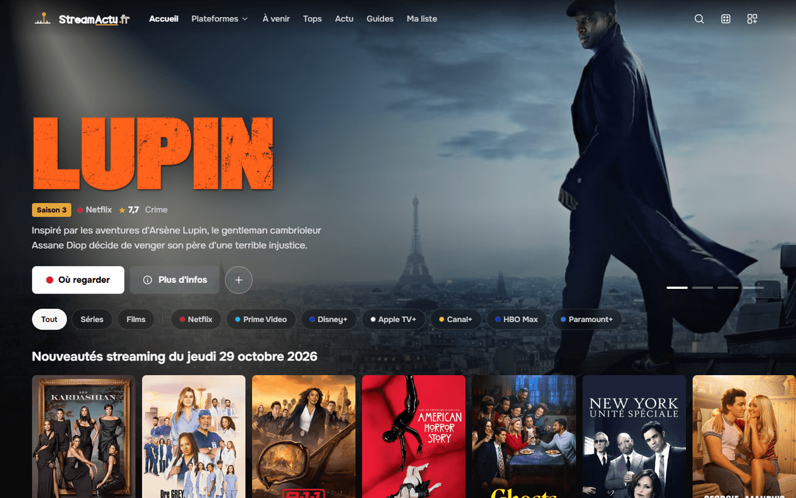

<div align="center">

# StreamActu.fr

**Veille streaming quotidienne — séries et films disponibles ce soir sur les grandes plateformes françaises.**

[](https://nextjs.org)
[](https://www.typescriptlang.org)
[](https://tailwindcss.com)
[](https://anthropic.com)

**[→ streamactu.fr](https://streamactu.fr)**

---



</div>

---

## Plateformes couvertes

<div align="center">

[](https://netflix.com)
[](https://primevideo.com)
[](https://disneyplus.com)
[](https://tv.apple.com)
[](https://canalplus.com)
[](https://www.hbomax.com)
[](https://paramountplus.com)

</div>

---

## Fonctionnalités

### Nouveautés quotidiennes
Chaque plateforme, chaque jour : séries et films triés par note des spectateurs, avec genres et casting. Navigation par jour, semaine ou mois, archives mensuelles et récap annuel par plateforme.

### Fiches séries et films
Où regarder en France, calendrier des épisodes de la saison en cours (avec la date française quand le décalage est prouvé), et le temps qu'il faut pour tout voir : durée de chaque saison et de toute la série, calculée sur les épisodes déjà diffusés.

### Ma liste, sans compte
Les titres à voir, gardés dans le navigateur (localStorage), avec un statut « Vu ». Le bloc **Quel abonnement ce mois-ci ?** croise la liste avec les abonnements cochés : lesquels garder, lesquels mettre en pause, quelle plateforme prendre ce mois-ci puis les suivants, avec le prix de l'offre la moins chère (relevé à la main dans [`lib/prix-abonnements.ts`](./lib/prix-abonnements.ts), à revoir chaque trimestre).

### Calendriers à ajouter à son agenda
Des flux iCalendar à ajouter à Google Agenda, Apple Calendrier ou Outlook : les sorties à venir (`/calendrier/prochaines-sorties.ics`), celles d'une plateforme (`/calendrier/netflix.ics`, …), et les nouveaux épisodes des séries de Ma liste.

### ✦ Convaincs-moi
Sur chaque fiche, un ami cinéphile IA vous pitche le contenu en 3-4 phrases pour vous convaincre de le regarder ce soir.

### ✦ Retrouveur
Vous vous souvenez vaguement d'un film — une ambiance, un acteur, une scène — mais plus du titre ? Décrivez-le, l'IA le retrouve et l'enrichit via TMDB.

### À la surprise
Un contenu aléatoire disponible en streaming FR, pour les indécis.

### Jeux quotidiens
Deux jeux renouvelés chaque jour : deviner le titre du jour ou reconnaître une pochette floutée — avec partage du résultat façon grille d'emojis.

### Actu
Chaque vendredi, [que regarder ce week-end](https://streamactu.fr/actu) ; en fin de mois, les nouveautés du mois suivant, plateforme par plateforme.

### Et aussi
Pages par plateforme et par genre, calendrier des prochaines sorties, tops mensuels et annuels (note pondérée par le nombre de votes), [guides](https://streamactu.fr/guides), flux RSS, `llms.txt` pour les assistants IA.

---

## Données

Données films et séries fournies par [TMDB](https://www.themoviedb.org) ; disponibilités par plateforme fournies par [JustWatch](https://www.justwatch.com/fr), via TMDB.
Ce produit utilise l'API TMDB mais n'est ni approuvé ni certifié par TMDB.

---

## Comment le projet est fait

- **Next.js 16** (App Router, rendu serveur et ISR), TypeScript, Tailwind CSS. Build `standalone` servi par Node derrière nginx/Passenger (Plesk).
- **Design** « La salle obscure » (octobre 2026) : fond noir, faisceau de projecteur, polices Onest et Big Shoulders.
- **Performance** : images servies par `next/image` (AVIF/WebP) à la taille réelle des cartes, affiches cachées à droite des rangées chargées au défilement, pas de préchargement des fiches depuis les cartes.
- **Sécurité** : en-têtes HSTS, CSP, COOP, Referrer-Policy et Permissions-Policy dans `next.config.ts`. La CSP garde `'unsafe-inline'` pour les scripts : Next écrit les données React dans la page, et les nonces imposeraient un rendu dynamique de toutes les pages (essai documenté dans `next.config.ts`).
- **Données** : API TMDB, mises en cache côté serveur (de 1 h à 7 jours selon la fraîcheur utile). Aucune base de données.
- **IA** : Claude Haiku (Anthropic) pour Convaincs-moi et le Retrouveur, avec limites par visiteur et plafonds quotidiens globaux.
- **Méthode des classements** : note TMDB pondérée par le nombre de votes, expliquée dans le guide [Comment sont classés les tops](https://streamactu.fr/guides/classement-tops).
- Le site a été développé avec l'aide de Claude, utilisé comme binôme pour le code et pour les premières versions des textes, vérifiés avant publication. Les listes, fiches et classements ne sont pas rédigés par une IA : ils sont calculés à partir des données TMDB.

---

## Lancer le projet

```bash
npm install
cp .env.example .env.local   # puis renseigner les clés
npm run dev                  # http://localhost:3000
npm test                     # tests (Vitest)
npm run lint
```

Variables d'environnement : voir [`.env.example`](./.env.example). Une clé ou un jeton d'API TMDB est nécessaire ; la clé Anthropic seulement pour les fonctions IA.

### Déploiement (build standalone)

```bash
mv .next/standalone .next/standalone-ancien   # si le site tourne depuis ce dossier
npm run build
cp -r public .next/standalone/
cp -r .next/static .next/standalone/.next/
# redémarrer l'application, puis supprimer .next/standalone-ancien
```

Sous PowerShell :

```powershell
Move-Item .nextstandalone .nextstandalone-ancien
npm run build
Copy-Item -Recurse public .nextstandaloneCopy-Item -Recurse .nextstatic .nextstandalone.nextRemove-Item -Recurse -Force .nextstandalone-ancien   # après le redémarrage
```

- `NEXT_PUBLIC_GA_ID` est intégré au moment du build : il doit être défini avant `npm run build`.
- Sur Plesk, l'adresse `/icons/` est réservée par Apache (404) : les icônes du site sont dans `public/icones/`.
- Revenir à la version d'avant la refonte : `git switch -c retour avant-refonte`, puis build et copie comme ci-dessus.

---

## Licence

Le code est publié sous licence [MIT](./LICENSE). Elle ne couvre que le code : les données et visuels issus de TMDB, les disponibilités issues de JustWatch, ainsi que les noms et logos des plateformes restent soumis à leurs propres conditions. Le nom et le logo StreamActu.fr ne sont pas couverts par la licence.
